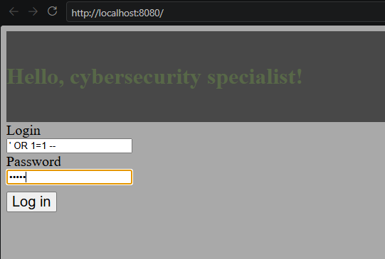
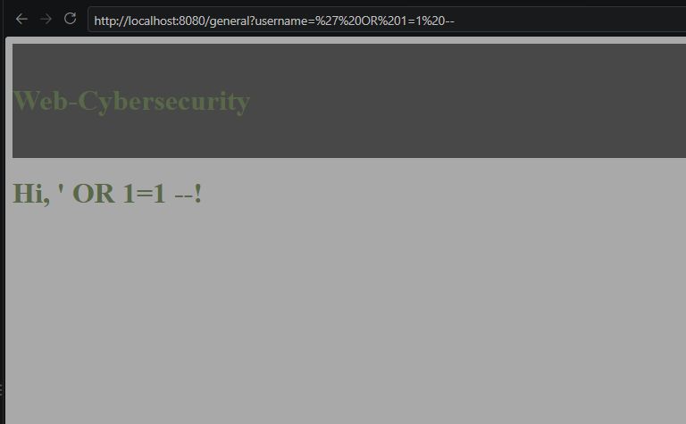
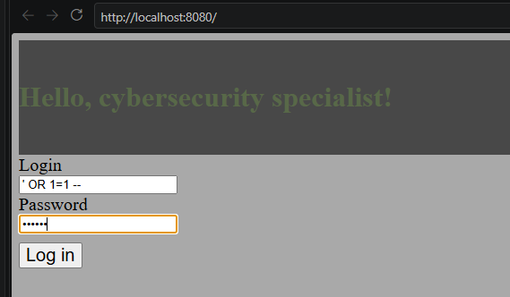
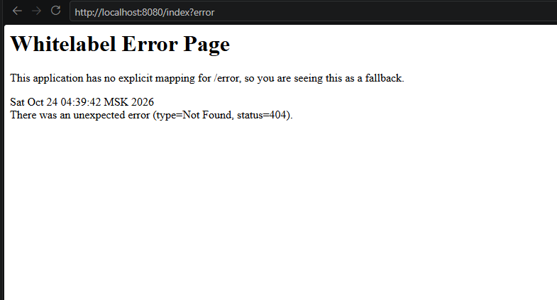
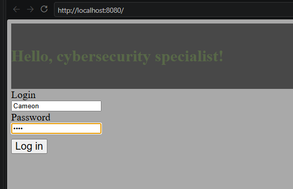
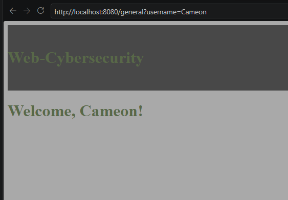

# 2. SQL-инъекция (CWE-089)

**Среда:** отдельная ветка sql-injection-demo, localhost

**Уязвимость:** SQL-запрос в файле VulnerableLoginDao.java собирается конкатенацией строк, без параметризации:

```java
String sql = "SELECT login, password FROM users WHERE login = '" + login + "'";
```

В зависимости от того, выводит ли контроллер результат в ответе, уязвимость проявляет себя как **in-band** (данные видны) или **blind** (инъекция сработала, но результат не виден).

**Воспроизведение:** При вводе в поле login мы обойдём авторизацию, без регистрации: `' OR 1=1 --`



**Результат:**



**Исправление:** Большинство SQL-инъекций можно избежать, используя параметризованные запросы вместо конкатенации строк:

```java
public interface UserRepository extends JpaRepository<User, Long> {
    Optional<User> findByLogin(String login);
}
```

А также стоит вводить черный список на использование таких символов, как дополнительный слой защиты: `';=-`

**Проверка:** Попробуем повторить воспроизведение:




Проверка работы базы данных:




**Вывод:** От SQL-инъекций легко защититься, но вред, который они несут, огромен, вплоть до потери базы данных. Для защиты достаточно использовать параметризованные запросы вместо конкатенации строк, а также вводить черные списки на определённые символы. Существуют два вида проявления уязвимости — blind и in-band, разница между ними в том, виден ли результат запроса атакующему напрямую.