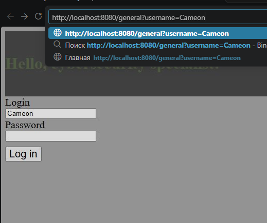
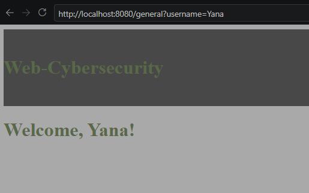
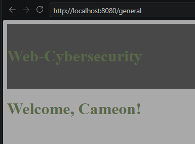

# 3. Отсутствие аутентификации для критичной функции (CWE-306) и Обход авторизации через управляемый пользователем ключ (CWE-639) (IDOR)

**Среда:** локальный стенд, тестовые данные

**Уязвимость:** IDOR - уязвимость, при которой пользователь может получить доступ к чужому объекту из-за  отсутствия проверок прав доступа.
- **CWE-306:** страница `/general` не проверяет, выполнен ли вход. Любой посетитель без сессии получает данные.
- **CWE-639:** после входа сервер не запоминает пользователя, а передаёт его ник в ссылке, и страница доверяет этому параметру:

```java
return "redirect:/general?username=" + user.get().getLogin();
```

Поэтому даже авторизованный пользователь может подставить чужой ник и открыть чужой профиль.

**Воспроизведение:**

1.  **CWE-306.** Переходим по прямой ссылке `/general?username=Cameon`.
2. **CWE-639.**  Входим как Cameon, затем в ссылке меняем ник на Yana:



3. Также попробуем перейти в профиль Yana:



**Результат:** сервер отдал страницу без входа и без проверки прав на чужой профиль. Ошибка 403 не возвращается.

**Исправление:** 

1.  `FormController`: сохраняем в сессии только логин

```java       
        // сбрасываем старую сессию, если она есть, и создаем новую
        HttpSession old = request.getSession(false);
        if (old != null) {
            old.invalidate();                      // защита от session fixation
        }
        HttpSession session = request.getSession(true);
        session.setAttribute("userLogin", user.get().getLogin());

        return "redirect:/general";
```

2. `AuthInterceptor`: закрывает страницу без входа (CWE-306)

```java
        @Override
        public boolean preHandle(HttpServletRequest request, HttpServletResponse response, Object handler) throws Exception {
            HttpSession session = request.getSession(false);
            if (session == null || session.getAttribute("userLogin") == null) {
                response.sendRedirect("/index");
                return false;
            }
            return true;
        }
```

3. `WebConfig`: подключение

```java
@Configuration
public class WebConfig implements WebMvcConfigurer {

    private final AuthInterceptor authInterceptor;

    public WebConfig(AuthInterceptor authInterceptor) {
        this.authInterceptor = authInterceptor;
    }

    @Override
    public void addInterceptors(InterceptorRegistry registry) {
        registry.addInterceptor(authInterceptor).addPathPatterns("/general", "/general/**");
        //сюда будут добавляться все защищенные страницы, которые требуют авторизации
    }
    
}
```

4. `MainController`: ник берётся из сессии, а не из ссылки (CWE-639)

```java
@GetMapping("/general")
public String general(HttpSession session, Model model) {
    String login = (String) session.getAttribute("userLogin");
    model.addAttribute("username", login);
    return "general";
}
```
 
**Проверка:** Теперь ник берётся из серверной сессии, что закрывает уязвимость CWE-639 и нельзя перейти по ссылке обойдя авторизацию, что закрывает уязвимость CWE-306



**Вывод:** Защита этих уязвимостей крайне важна, так как без нее теряется смысл добавления авторизации на сайте. 