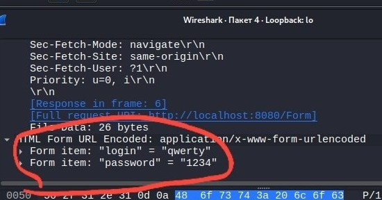
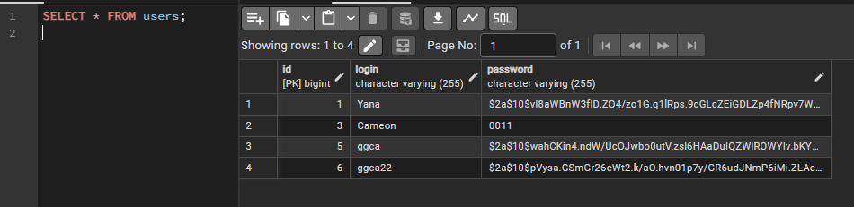

# Открытое хранение пароля (CWE-256)

**Среда:** локальный стенд, тестовые данные

**Уязвимость:** Наш пароль не шифруется при отправке к базе данных. При использовании анализа трафика с помощью wireshark, можно увидеть пароль. 

```
        repository.save(new User(login, password)); // Нужно захешировать
        return "redirect:/?success";
```

**Воспроизведение:** 

Помните как мы анализировали трафик с помощью [wireshark](cybersecurity/CWE-Vulnerabilities/1-CWE-319.md)? Тоже самое воспроизведение как и там.

**Результат:**

Перехваченные данные:



**Исправление:** 

Используем модуль crypto, добавим его в `pom.xml`:

```
<dependency>
  <groupId>org.springframework.security</groupId>
  <artifactId>spring-security-crypto</artifactId>
</dependency>
```

Создаем объект `PasswordConfig.java`:
```
@Configuration
public class PasswordConfig {
    @Bean
    public PasswordEncoder passwordEncoder() {
        return new BCryptPasswordEncoder();
    }
}
```

В шифруем пароль `RegistrationController.java`:
```
    private final PasswordEncoder encoder;
```

Проверяем пароль теперь таким же способом `FormController.java`:
```
    if (user.isEmpty() || !encoder.matches(password, user.get().getPassword())) {
        return "redirect:/";
    }
```

**Проверка:** повторная попытка после исправления

Чтобы не лезть снова в kali, легче показать все в pgadmin 4, делаем несложный запрос и получаем вот такую таблицу, сразу видно сделанные до и после хеширования:




**Вывод**

Нужно хешировать пароли, для дополнительного слоя защиты. Не забывать использовать актуальные методы хеширования.