# Cybersecurity Report — web_cybersecurity

Документация по уязвимостям, найденным и воспроизведённым в учебных целях в этом проекте, и способам их устранения.

---

## Содержание

0. [Шаблон](#0-название-уязвимости-cwe-xxx)

1. [Передача данных в открытом виде http (CWE-319)](#1-передача-данных-в-открытом-виде-http-cwe-319)

2. [SQL-инъекция (CWE-089)](#2-sql-инъекция-cwe-089)

3. [Отсутствие аутентификации для критичной функции (CWE-306) и Обход авторизации через управляемый пользователем ключ (CWE-639)](#3-отсутствие-аутентификации-для-критичной-функции-cwe-306-и-обход-авторизации-через-управляемый-пользователем-ключ-cwe-639)

---

### 0. Название уязвимости (CWE-XXX)

**Среда:** локальный стенд, тестовые данные

**Уязвимость:** где и почему возникла

**Воспроизведение:** инструмент, шаги (без реальных данных)

**Результат:** что удалось получить

**Исправление:** что изменено в коде или конфигурации

**Проверка:** повторная попытка после исправления

**Вывод:** чему научился

---

### 1. Передача данных в открытом виде http (CWE-319)

**Среда:** Локальная сеть, http://localhost:8080

**Уязвимость:** При использовании протокола http мы не шифруем свои данные, любой кто захочет посмотреть их - посмотрит.

**Воспроизведение:**

1. Открываем Wireshark. Жертва вводит свои данные на сайте (Пример: login: qwerty, password: 1234). 

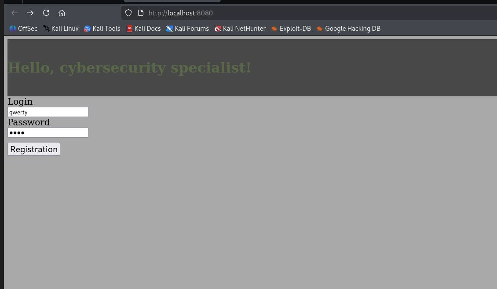

2. Инструмент Wireshark запущен на локальном интерфейсе (Loopback: lo).
3. Применяем фильтр (можно ввести либо сам айпи адрес через ip.addr == xxx.xxx.xxx.xxx; либо ввести port==8080 - порт, на котором запущен наш локальный сервер).
4. Находим POST-запрос и открываем его. 

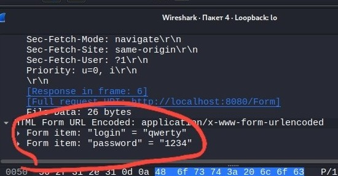

**Результат:** Мы перехватили трафик, и узнали логин и пароль login: qwerty, password: 1234. 

**Исправление:** В рамках локального стенда тестирование уязвимости завершено.

**Проверка:** В реальных условиях при использовании HTTPS перехват трафика в Wireshark покажет зашифрованный протокол TLS (Application Data). Прочитать логин и пароль будет невозможно.

**Вывод:**  Передача данных по http - критическая уязвимость. Для ее устранения не нужно писать сложный код: правильнее передать обеспечение шифрования https хостинг-провайдеру или использовать облачные платформы. Провайдер решает проблему на уровне инфраструктуры: автоматически выпускает SSL/TLS-сертификат (обычно через Let's Encrypt), устанавливает его на свой балансировщик/CDN, включает принудительный редирект с http на https и берёт на себя автоматическое обновление сертификата. Код приложения при этом не меняется - он просто работает за защищённым слоем провайдера.

---

### 2. SQL-инъекция (CWE-089)

**Среда:** отдельная ветка sql-injection-demo, localhost

**Уязвимость:** SQL-запрос в файле VulnerableLoginDao.java собирается конкатенацией строк, без параметризации:

```java
String sql = "SELECT login, password FROM users WHERE login = '" + login + "'";
```

В зависимости от того, выводит ли контроллер результат в ответе, уязвимость проявляет себя как **in-band** (данные видны) или **blind** (инъекция сработала, но результат не виден).

**Воспроизведение:** При вводе в поле login мы обойдём авторизацию, без регистрации: `' OR 1=1 --`

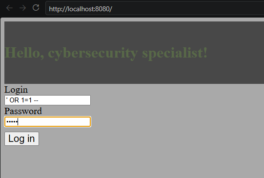

**Результат:**

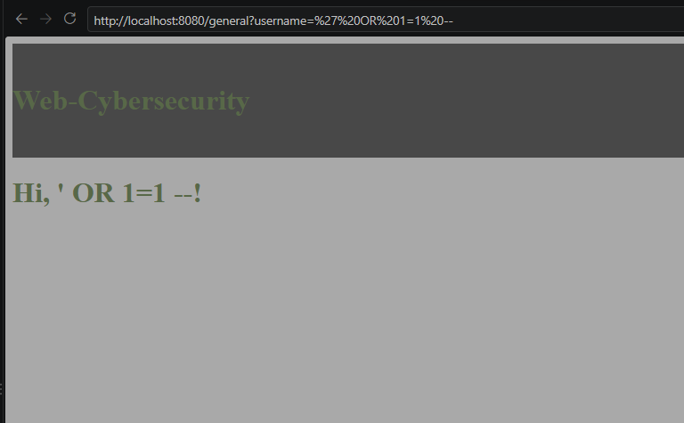

**Исправление:** Большинство SQL-инъекций можно избежать, используя параметризованные запросы вместо конкатенации строк:

```java
public interface UserRepository extends JpaRepository<User, Long> {
    Optional<User> findByLogin(String login);
}
```

А также стоит вводить черный список на использование таких символов, как дополнительный слой защиты: `';=-`

**Проверка:** Попробуем повторить воспроизведение:

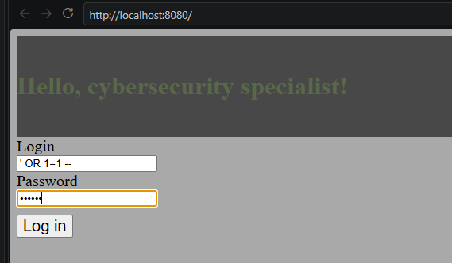
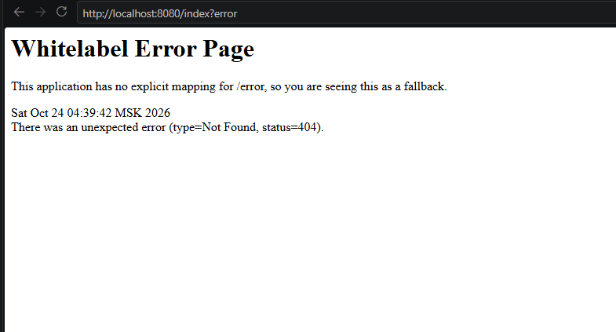

Проверка работы базы данных:

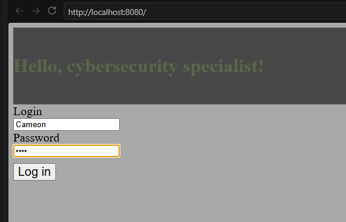
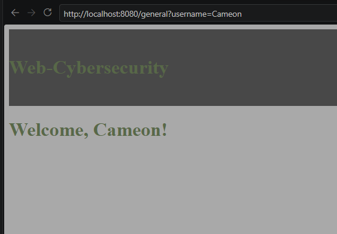

**Вывод:** От SQL-инъекций легко защититься, но вред, который они несут, огромен, вплоть до потери базы данных. Для защиты достаточно использовать параметризованные запросы вместо конкатенации строк, а также вводить черные списки на определённые символы. Существуют два вида проявления уязвимости — blind и in-band, разница между ними в том, виден ли результат запроса атакующему напрямую.


---

### 3. Отсутствие аутентификации для критичной функции (CWE-306) и Обход авторизации через управляемый пользователем ключ (CWE-639)

**Среда:** локальный стенд, тестовые данные

**Уязвимость:** 
- **CWE-306:** страница `/general` не проверяет, выполнен ли вход. Любой посетитель без сессии получает данные.
- **CWE-639:** после входа сервер не запоминает пользователя, а передаёт его ник в ссылке, и страница доверяет этому параметру:

```java
return "redirect:/general?username=" + user.get().getLogin();
```

Поэтому даже авторизованный пользователь может подставить чужой ник и открыть чужой профиль.

**Воспроизведение:**

1.  **CWE-306.** Переходим по прямой ссылке `/general?username=Cameon`.
2. **CWE-639.**  Входим как Cameon, затем в ссылке меняем ник на Yana:

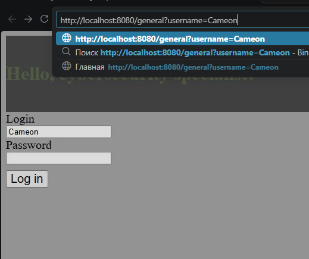

3. Также попробуем перейти в профиль Yana:

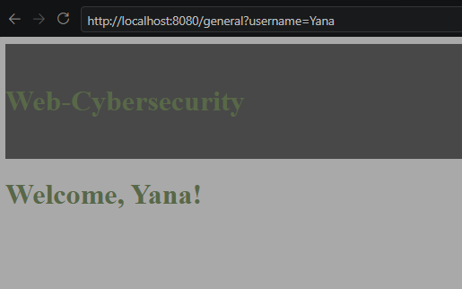

**Результат:** сервер отдал страницу без входа и без проверки прав на чужой профиль. Ошибка 403 не возвращается.

**Исправление:** 

1.  `FormController`: сохраняем в сессии только логин

```java       
        // сбрасываем старую сессию, если она есть, и создаем новую
        HttpSession old = request.getSession(false);
        if (old != null) {
            old.invalidate();                      // защита от session fixation
        }
        HttpSession session = request.getSession(true);
        session.setAttribute("userLogin", user.get().getLogin());

        return "redirect:/general";
```

2. `AuthInterceptor`: закрывает страницу без входа (CWE-306)

```java
        @Override
        public boolean preHandle(HttpServletRequest request, HttpServletResponse response, Object handler) throws Exception {
            HttpSession session = request.getSession(false);
            if (session == null || session.getAttribute("userLogin") == null) {
                response.sendRedirect("/index");
                return false;
            }
            return true;
        }
```

3. `WebConfig`: подключение

```java
@Configuration
public class WebConfig implements WebMvcConfigurer {

    private final AuthInterceptor authInterceptor;

    public WebConfig(AuthInterceptor authInterceptor) {
        this.authInterceptor = authInterceptor;
    }

    @Override
    public void addInterceptors(InterceptorRegistry registry) {
        registry.addInterceptor(authInterceptor).addPathPatterns("/general", "/general/**");
        //сюда будут добавляться все защищенные страницы, которые требуют авторизации
    }
    
}
```

4. `MainController`: ник берётся из сессии, а не из ссылки (CWE-639)

```java
@GetMapping("/general")
public String general(HttpSession session, Model model) {
    String login = (String) session.getAttribute("userLogin");
    model.addAttribute("username", login);
    return "general";
}
```
 
**Проверка:** Теперь ник берётся из серверной сессии, что закрывает уязвимость CWE-639 и нельзя перейти по ссылке обойдя авторизацию, что закрывает уязвимость CWE-306

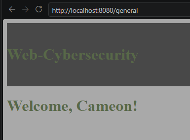

**Вывод:** Защита этих уязвимостей крайне важна, так как без нее теряется смысл добавления авторизации на сайте. 

---